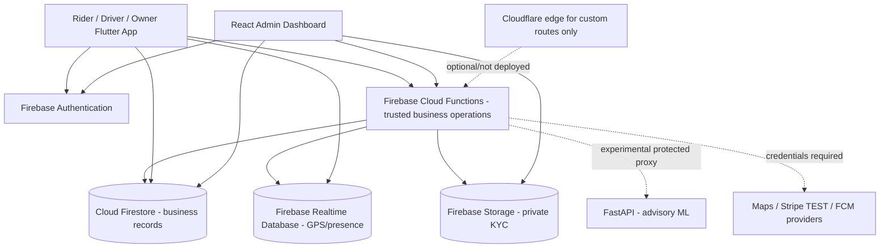

# DRIVE — Final Software Engineering Project Report

**DRIVE: Smart Ride-Sharing and Vehicle Rental Platform**  
**Course:** CSE412 Software Engineering, East West University  
**Semester:** Fall 2026  
**Version:** Final academic draft, 18 October 2026  
**Repository:** https://github.com/shoraimw/CSE412_Drive  
**Status:** Core source implemented and automated CI passing; external staging deployment and complete product requirements not yet verified.

> **Submission integrity notice.** This report distinguishes what the source code implements, what CI confirms, and what is not yet tested or delivered. Team member names, final results from actual staging, test screenshots and supervisor sign-off must be filled in by the submitting team.

## Abstract

DRIVE is an academic ride-hailing and vehicle-rental software platform that supports riders, approved drivers, vehicle owners and administrators. The solution uses Flutter for a role-aware mobile client, React/Vite for a protected administration console, Firebase Authentication and Cloud Functions for identity and trusted workflows, Firestore for business records, Realtime Database for location updates and Firebase Storage for private application evidence. Optional FastAPI-based machine-learning and Cloudflare-edge components illustrate the difference between experimental intelligence, perimeter rate limiting and actual production deployment. The implemented source demonstrates account registration, driver/owner onboarding, vehicle listing and rental conflict protection, ride booking and dispatch, limited live location, ride state transitions, cash/Stripe TEST payment support, service dispute review, role-bound access, audit logs and configurable fare pricing. On 18 October 2026, the full multi-surface CI and Firebase emulator integration suites passed on a known commit. Real Firebase staging, physical-device integration, live gateway protections, complete public-safety features, cost sharing, multi-currency financial settlement, tourist recommendations and a verified million-user capacity are **not complete**. This report documents design choices, security boundaries, verified tests, limitations and a credible acceptance plan.

## 1. Introduction

### 1.1 Problem statement

Riders need trustworthy ways to find available, approved drivers, understand fare estimates and track trips. Independent vehicle owners need a safe rental marketplace where booking conflicts are prevented. Administrators need auditable oversight of identity checks, complaints and pricing. An integrated platform must protect against unauthorized state changes, identity-document exposure and fraudulent payment notifications. DRIVE provides an educational implementation for exploring these challenges in the Bangladesh setting, using BDT as the default currency.

### 1.2 Objectives

1. Model actors and functional/non-functional requirements in a traceable SRS.
2. Implement user authentication, authorization and verified driver/owner workflows.
3. Provide rider booking, driver matching, ride history and time-bounded rental logic.
4. Prevent unauthorized fare, role, booking and payment transitions on the server.
5. Build an auditable administrator interface for onboarding, disputes and pricing.
6. Evaluate software quality using automated tests and staged release controls.
7. Prototype advisory ML services and optional WAF/edge control while identifying unvalidated claims.

### 1.3 Scope

The system is an **academic prototype**, not an insured public transportation operator, production payment settlement platform or emergency-service substitute. Google Maps and Stripe TEST dependencies require independently configured API keys. Source presence alone does not prove end-to-end user acceptance.

## 2. Software Development Approach

The team structured implementation into ten milestones: (1) SRS/architecture, (2) Firebase trusted backend, (3) Flutter foundation, (4) rider booking, (5) driver operations, (6) payments/chat/notifications, (7) experimental ML/scalability/security, (8) admin operations, (9) QA/CI/staging, and (10) report/presentation/demo. The development approach mixes incremental delivery with frequent automated regression checks. A milestone is not accepted solely because it has code; proof requires tests and external environment setup where applicable.

### 2.1 Actors

| Role | Allowed activities | Key restriction |
|---|---|---|
| Rider | Profile, own ride requests, rental browsing/booking, own cases | Cannot set authoritative fare, assigned driver or payment state |
| Approved driver | Availability, dispatch offers, own ride state/location | Must pass server-side verification; cannot impersonate another driver |
| Approved owner | Vehicle listing and own rental booking management | Cannot self-approve, modify another owner's evidence, or double-book |
| Admin | Approval, exact account lookup, case triage, pricing, audit | Only trusted Firebase custom claim; no role grant by web page |
| Experimental ML | Optional predictions | Advisory only, no authority to change fare/safety/payment truth |

## 3. Requirements and Honest Completion Status

The original submitted requirement analysis contains 12 top-level functional features. The canonical details are the [traceability matrix](REQUIREMENTS_TRACEABILITY.md).

| Feature | Status at report cutoff | Remaining concern |
|---|---|---|
| Authentication & security | Baseline implemented | Real OAuth/OTP, device and App Check rollout |
| User management | Partial | Account suspension and staffed moderation |
| Vehicle rental | Source and emulator tests implemented | Live mobile/staging acceptance; rental payment |
| Smart ride booking | Implemented in source | Real Maps and Firebase project test |
| Smart matching and cost sharing | Partial | Shared-passenger detours and split fares |
| Real-time ride tracking | Partial | Background GPS/battery/scale/device privacy checks |
| Smart fare prediction | Rule-based trusted fare; experimental ML | Genuine traffic data, trained model approval |
| AI route optimization | Basic Google Routes/navigation | Validated alternative-route optimization |
| Multi-currency payment | Cash and Stripe TEST source | More currencies, FX, rentals, live reconciliation |
| Women Safety Mode | Not completed | Preferences, eligible-driver filtering, trusted contact delivery |
| Smart emergency/safe trip | Internal incident logging | Real emergency escalation and contacts |
| Tourist Mode | Not implemented | Places, preference and multi-stop itinerary UX |

The report's demonstration **must not** call every PDF feature complete. The optional Cloudflare code is **not deployed**, and the SDK's direct Firebase traffic does **not** pass through that Worker.

## 4. Architecture

### 4.1 Component diagram

The diagram distinguishes central trusted server controls from client reads permitted by security rules. The Cloudflare Worker serves explicitly configured custom routes only, not Google's directly accessed Firebase endpoints.

### 4.2 Major implementation modules

- **Mobile:** `apps/mobile` — Flutter role-aware screens, form validation, localizations and reusable domain objects.
- **Admin:** `apps/admin` — React dashboard with 12 views, cursor pagination, bounded analytic samples, support case review and pricing.
- **Backend:** `services/functions` — Firebase callable/server workflows, state transitions, trusted pricing, matching, approval, payment and incident operations.
- **Data rules:** `firebase/*.rules` — Firestore/Storage/RTDB role and ownership authorization.
- **ML:** `services/ml` — FastAPI API and time-split training pipeline; no approved live model.
- **Edge:** `infra/cloudflare` — optional custom-domain Worker, WAF/rate-limit building blocks; not a universal Firebase security shield.
- **Testing:** `tests/firebase`, `tests/integration`, `tests/qa`, `tests/load` and app/service-specific suites.

### 4.3 Data boundaries

Firebase Auth tokens establish identity, while trusted custom claims and server-verified approval records grant privileged actions. Firestore stores durable ride, rental, pricing, review and audit information. RTDB handles short-lived driver/trip location streams; read/write rules restrict identities and trip participants. Private documents use Firebase Storage rules. Only the server may make final state transitions or publish authoritative fare and payment records.

## 5. Key Workflows and Design Decisions

### 5.1 Account and driver approval

A user authenticates, creates a limited public profile and submits application information. KYC documents use immutable-versioned storage paths and cannot be casually overwritten. An admin reviews driver/owner/vehicle requests; approval controls driver online eligibility or listing visibility. The browser does not grant custom roles.

### 5.2 Booking and dispatch

The rider supplies pickup/destination/vehicle type. Cloud Functions return server-calculated BDT fare and persist the booking state. Nearby-driver selection uses geohash-based location querying and time-bound offers. Acceptance is server-side to prevent two drivers acquiring the same trip. Location and trip state are limited by permissions. Real-world matching latency and density-based capacity have not been measured.

### 5.3 Rental conflict prevention

Approved owners list vehicles with rates and availability. Renters choose time windows. Server transactions/lock slots prevent overlapping accepted rental windows; test coverage includes cancellation and conflict behavior. The precise UX and time-zone behavior still need real-device acceptance.

### 5.4 Payment and messaging

The project contains cash confirmation, signed Stripe **TEST** webhook validation, participant chat records, rating and notification integration. It does not process production refunds or payouts. A successful test payment is not equivalent to regulatory authorization, live reconciliation or multicurrency settlement.

### 5.5 Admin dispute, privacy and pricing

The admin console supports trusted account lookup, application review, safety incident triage, service dispute intake and audited priority/reviewer assignment, state transitions and pricing versions. A case resolution records an administrative decision; it does not automatically refund money or send emergency dispatch. Pricing publication uses optimistic concurrency so a stale administrator cannot silently replace newer active configuration.

## 6. Algorithms and Experimental ML

The baseline approach uses geohash radius bounds to narrow driver candidates and trusted distance/time/vehicle inputs to generate a fare estimate. The Python service explores historical fare, ETA, demand and anomaly signals using a versioned time-split validation pipeline. It needs consented, de-identified historic datasets and safe approved model artifacts before live inference. No reported MAE, precision, recall or model speed should be invented. Algorithm details are documented in the [Phase 7 report](PHASE_7_ML_SCALABILITY_SECURITY.md).

## 7. Software Testing and Evidence

The [Phase 9 acceptance plan](PHASE_9_ACCEPTANCE_TEST_PLAN.md) lists 22 reproducible test cases. Automated evidence is:

| Automated domain | Reference result (18 Oct 2026) |
|---|---|
| Full Firebase Auth/Firestore/RTDB/Storage rules, backend and integration | [Success — run 39129534843](https://github.com/shoraimw/CSE412_Drive/actions/runs/39129534843) |
| Phase 9 Flutter, admin, ML, edge and QA release gate | [Success — run 39129534777](https://github.com/shoraimw/CSE412_Drive/actions/runs/39129534777) |

These checks run on a specific commit, not on hypothetical future releases. They do not prove physical-device success or a live Firebase staging deployment. Real-device and staging acceptance must record PASS/FAIL/BLOCKED/NOT RUN individually, with test logs/screenshots and reviewer attribution. [Release sign-off](PHASE_9_RELEASE_SIGNOFF.md) is blank pending owner evidence.

### 7.1 Verified defects and corrections

During integration QA, dispatch failed with a missing `geohash` index error even though the rules file defined it. The project fixed RTDB emulator namespace/rules alignment and verified this with passing Firebase integration CI. Admin document access logic was hardened against missing custom claims. This demonstrates why automated release gates matter beyond a feature checklist.

### 7.2 Deployment status

Only source, CI and staged workflows are currently verified. Firebase Hosting/admin cloud, Cloudflare Worker, Google Maps credentials and IAM are not automatically provisioned. Without a separate staging Firebase/GCP account and team-controlled secrets, claiming the application is deployed would be inaccurate. The planned deploy is deliberately **manual**, dedicated to isolated staging, and blocked until a green CI run on the same source SHA.

## 8. Security, Privacy and Scale

Security is layered: Firebase Authentication, trusted backend checks, security rules, immutable audit events, private KYC evidence, staging-target validation, CI secret-pattern checks and optional web App Check. Real-world deployment must add IAM separation, cloud quotas, WAF controls, data-retention rules, provider credential rotation, staging pen-test, incident response and operational backups.

DDoS can be mitigated, **not eliminated**. Cloudflare optional edge components do not protect traffic sent from official Firebase SDKs directly to Google's endpoints. Safe initial `k6` checks probe a staging `/healthz` endpoint at five virtual users for one minute only. No evidence supports a one-million-user throughput claim. Scaling would require measured partitioning, geo indexing, controlled writes, real query load, quota/budget monitoring, and redesign of hot data paths.

## 9. Limitations and Ethical Responsibilities

Incomplete PDF features include actual passenger cost sharing, multi-currency settlement, full Women Safety Mode, external emergency escalation, Tourist Mode, and integrated real-data model validation. An incident button cannot be marketed as automatic ambulance/police dispatch. Admin audits and encrypted transport are not substitutes for legal compliance or consent. Never expose KYC, personally identifiable data, maps server credentials, payment secrets or production accounts during a university demonstration. Present `demo-drive-local` as local test infrastructure.

## 10. Deployment Plan and Release Risks

1. Complete the green CI gate on the release SHA.
2. Create a separate billing-limited Firebase/GCP staging project.
3. Configure service accounts, OIDC/Workload Identity, admin Auth domain, Storage/CORS and data rules.
4. Manually release to staging using GitHub Environment approval, validate HTTPS/public admin response.
5. Perform 22 test cases on staging and real Android devices, and save evidence.
6. Review WAF/App Check provider integration, budget, p95/p99, logging and backup/rollback.
7. Freeze demo scope and collect faculty review; **do not deploy to production** without independent operations/security and legal approval.

### Risk register

| Risk | Likelihood | Impact | Mitigation |
|---|---|---|---|
| Firebase staging absent | High | High | Track explicit external blocker, do not claim deployed |
| Unauthorized role / exposed KYC | Medium | Critical | Custom claims, deny-by-default rules, emulator + staging tests |
| Duplicate booking/assignment | Medium | High | Server transaction, conflict and idempotency tests |
| Maps / Stripe secrets leaked | Medium | Critical | Environment secrets, CI scanning, restricted provider keys |
| GPS/drivers under load | Unknown | High | Real devices, region data tests, cost-limited staged profiling |
| Unverified emergency promise | High | Critical | Clear "internal reporting only" labelling and demo disclaimer |
| Unapproved ML model | High | Medium | Advisory only, explicit model readiness and 503 fallback |

## 11. Future Work

Priorities after the university demonstration: complete shared trip/cost splitting, rental payment, selected currency provider conversion and reconciliation, Women Safety Mode with explicit consent, trusted-contact escalation, Tourist Mode, real route alternatives, accessible/low-bandwidth offline UX, and measured high-density driver matching. Before any real launch, conduct independent privacy/security reviews and staged performance tests using representative traffic.

## 12. Conclusion

DRIVE demonstrates a credible multi-role ride-hailing and rental software architecture, server-authoritative booking/pricing and dispute workflows, and an automated quality gate that has caught and validated an integration defect. It is a meaningful **academic software engineering prototype**, not a finished commercial Uber alternative. Its value is the transparency of requirements, architecture, source code, authorization and observed tests. Graduation/project submission should describe Phase 9 live acceptance and every unimplemented feature precisely, rather than checking boxes without evidence.

## References / Project artefacts

1. Original `412_Project_Requirement.pdf`, team requirement analysis submitted 6 October 2026 (source baseline).
2. `docs/PHASE_1_SRS_ARCHITECTURE.md` — complete design and SRS.
3. `docs/REQUIREMENTS_TRACEABILITY.md` — source status vs complete functional scope.
4. `docs/PHASE_7_ML_SCALABILITY_SECURITY.md` — experimental ML, Cloudflare, scaling and risk limitations.
5. `docs/PHASE_8_ADMIN_OPERATIONS.md` — exact account lookup, support case and pricing.
6. `docs/PHASE_9_QA_RELEASE.md` and `docs/PHASE_9_ACCEPTANCE_TEST_PLAN.md` — CI, staging, manual acceptance.
7. GitHub repository and CI: https://github.com/shoraimw/CSE412_Drive .

**Team members:** [ADD SUBMITTING TEAM NAMES / IDS]  
**Supervisor/instructor:** [ADD VERIFIED NAME]  
**Final submission date:** [ADD DATE]  
**Staging test evidence (if actually executed):** [ADD URLs OR LABEL BLOCKED]
